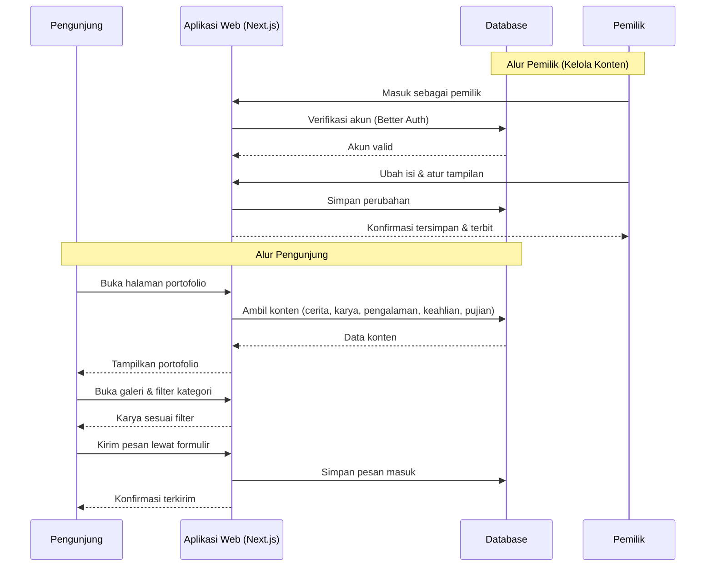
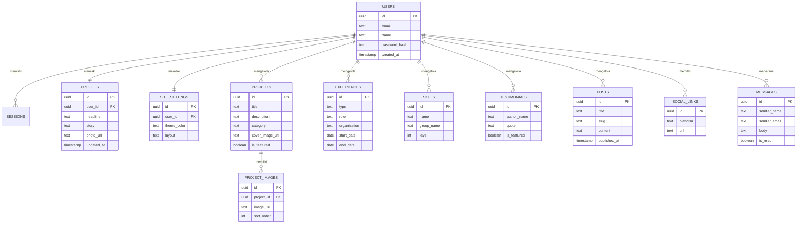

# PRD — Project Requirements Document

## 1. Overview

Portofolio personal saat ini sering tersebar di banyak tempat (media sosial, CV, file PDF) sehingga terkesan kurang profesional dan sulit diingat orang. Aplikasi ini bertujuan membangun **satu halaman portofolio pribadi yang keren, profesional, dan mudah diingat**, yang langsung menceritakan siapa kamu lewat cerita singkat, karya pilihan, riwayat pengalaman, keahlian, dan pujian dari orang lain.

**Tujuan utama:**
- Menampilkan identitas dan cerita dirimu dengan kesan pertama yang profesional.
- Memudahkan pengunjung melihat karya, pengalaman, dan keahlian dalam satu tempat.
- Memudahkan pengunjung menghubungimu untuk peluang kerja atau kerja sama.
- Membuatmu bisa memperbarui isi portofolio sendiri tanpa bantuan orang lain.
- Menjadi "kartu nama hidup" yang mudah diingat dan dibagikan.

## 2. Requirements

**Kebutuhan fungsional:**
- Halaman beranda yang langsung memperkenalkan diri lewat cerita singkat dan karya sorotan.
- Galeri karya dengan filter kategori dan pratinjau gambar besar.
- Riwayat pengalaman kerja/sekolah dalam bentuk linimasa.
- Daftar keahlian lengkap dengan tingkat kemampuan dan pengelompokan.
- Bagian pujian dari orang lain yang bisa ditonjolkan.
- Tombol hubungi yang selalu terlihat + formulir pesan + tautan sosial.
- Halaman tulisan/kabar terbaru agar pengunjung mau kembali.
- Panel khusus pemilik untuk mengubah isi portofolio.

**Kebutuhan non-fungsional:**
- Tampilan responsif (nyaman di HP, tablet, dan desktop).
- Muat cepat dan enak dipindai mata.
- Desain konsisten dan profesional sesuai personal branding.
- Hanya pemilik yang bisa masuk untuk mengubah konten.
- Ramah mesin pencari (SEO) agar mudah ditemukan.
- Biaya operasional ringan (cocok untuk kebutuhan pribadi).

## 3. Core Features

### Fase 1 — Fondasi Kesan Pertama
- **Beranda Cerita** [high] — Halaman pertama yang langsung memperkenalkan siapa kamu lewat cerita singkat dan karya pilihan.
  - Sapaan Pembuka — nama, foto, dan satu kalimat tentang dirimu.
  - Cerita Singkat — ringkasan kisah tentang dirimu.
  - Sorotan Karya — beberapa karya terbaik yang tampil di halaman depan.
  - Menu Navigasi — tautan cepat ke bagian lain portofolio.
- **Galeri Karya** [high] — tempat menampilkan foto dan hasil kerja dengan rapi.
  - Kumpulan Karya — semua karya dalam susunan yang mudah dipindai.
  - Detail Karya — penjelasan singkat saat karya dibuka.
  - Filter Kategori — menyaring karya berdasarkan jenis/bidang.
  - Pratinjau Gambar — melihat gambar karya dalam ukuran besar dan jelas.

### Fase 2 — Membangun Kredibilitas
- **Riwayat Pengalaman** [medium] — perjalanan kerja dan sekolah secara berurutan.
  - Linimasa Pengalaman — daftar dari yang paling baru.
  - Detail Pengalaman — peran, tempat, dan waktu.
  - Pencapaian Penting — hal menonjol di tiap pengalaman.
- **Daftar Keahlian** [medium] — kemampuan dan bidang yang dikuasai.
  - Daftar Keahlian — daftar yang mudah dibaca.
  - Tingkat Kemampuan — seberapa mahir di tiap keahlian.
  - Kelompok Keahlian — dikelompokkan berdasarkan bidang.
- **Kata Pujian** [medium] — kesan baik dari orang yang pernah bekerja bersamamu.
  - Daftar Pujian — kumpulan pujian di satu tempat.
  - Asal Pemberi — nama, jabatan, dan asal pemberi pujian.
  - Pujian Pilihan — pujian terbaik ditampilkan lebih menonjol.

### Fase 3 — Interaksi & Kunjungan Ulang
- **Hubungi Aku** [medium] — memudahkan pengunjung menghubungimu.
  - Tombol Hubungi — selalu terlihat agar bisa langsung dihubungi.
  - Formulir Pesan — pengunjung bisa mengirim pesan dari halaman portofolio.
  - Tautan Sosial — tautan ke akun sosial dan surel.
  - Konfirmasi Terkirim — pesan bahwa pesan berhasil dikirim.
- **Kabar Terbaru** [low] — tulisan dan pembaruan agar pengunjung kembali lagi.
  - Tulisan Terbaru — daftar tulisan/catatan terbaru.
  - Baca Tulisan — halaman membaca satu tulisan secara utuh.
  - Tanda Pembaruan — penanda saat ada isi baru.

### Fase 4 — Kontrol Penuh untuk Pemilik
- **Kelola Konten** [medium] — tempat kamu mengubah isi portofolio sendiri.
  - Masuk Pemilik — hanya kamu yang bisa masuk untuk mengubah isi.
  - Ubah Isi — menambah/memperbarui karya, cerita, dan keahlian.
  - Atur Tampilan — memilih warna, tata letak, dan foto utama.
  - Simpan & Terbitkan — menyimpan perubahan dan langsung menampilkannya ke pengunjung.

## 4. User Flow

**Alur Pengunjung (agar mudah diingat & terhubung):**
1. Pengunjung membuka tautan portofolio.
2. **Sapaan Pembuka** menyambut dengan nama, foto, dan satu kalimat.
3. Pengunjung membaca **Cerita Singkat** tentang dirimu.
4. Pengunjung melihat **Sorotan Karya** di beranda, lalu masuk ke **Galeri Karya** dan menyaring sesuai kategori yang diminati.
5. Pengunjung menelusuri **Riwayat Pengalaman**, **Daftar Keahlian**, dan **Kata Pujian** untuk menilai kredibilitas.
6. Pengunjung membaca **Kabar Terbaru** bila ingin tahu aktivitas terkini.
7. Pengunjung menekan **Tombol Hubungi**, mengisi **Formulir Pesan**, dan mendapat **Konfirmasi Terkirim**.

**Alur Pemilik (mengelola konten):**
1. Pemilik membuka halaman **Masuk Pemilik**.
2. Setelah masuk, pemilik **Mengubah Isi** (karya, cerita, keahlian, pengalaman, pujian).
3. Pemilik **Mengatur Tampilan** (warna, tata letak, foto utama).
4. Pemilik memilih **Simpan & Terbitkan** — perubahan langsung terlihat pengunjung.

## 5. Architecture

Aplikasi dibangun sebagai satu aplikasi web full-stack: antarmuka (frontend) dan logika server (backend) berada dalam satu proyek, dengan database untuk menyimpan konten. Pengunjung mengakses halaman publik secara read-only, sementara pemilik masuk untuk mengelola konten melalui panel khusus.

**Komponen utama:**
- **Antarmuka (Frontend):** halaman publik (beranda, galeri, pengalaman, keahlian, pujian, kabar terbaru) + panel pemilik.
- **Server (Backend):** mengelola permintaan data, autentikasi pemilik, dan penyimpanan pesan.
- **Database:** menyimpan profil, karya, pengalaman, keahlian, pujian, tulisan, pesan, dan pengaturan tampilan.
- **Penyimpanan Gambar:** menampung foto profil, gambar karya, dan foto pendukung.

## 6. Database Schema

Berikut tabel utama yang dibutuhkan. Kolom **id** pada tiap tabel adalah kunci unik (UUID/integer auto).

**users** — akun pemilik portofolio (untuk login).
- id: UUID — kunci unik.
- email: text — surel untuk masuk.
- name: text — nama pemilik.
- password_hash: text — kata sandi terenkripsi (ditangani Better Auth).
- created_at: timestamp — waktu akun dibuat.

**sessions** — sesi login pemilik.
- id: UUID — kunci unik sesi.
- user_id: UUID — mengacu ke users.
- token: text — token sesi.
- expires_at: timestamp — waktu kedaluwarsa.

**profiles** — identitas & cerita utama di beranda.
- id: UUID — kunci unik.
- user_id: UUID — pemilik profil.
- headline: text — satu kalimat tentang dirimu (sapaan pembuka).
- story: text — cerita singkat tentang dirimu.
- photo_url: text — foto utama.
- updated_at: timestamp — waktu terakhir diubah.

**projects** — daftar karya untuk galeri & sorotan beranda.
- id: UUID — kunci unik.
- title: text — judul karya.
- description: text — detail karya.
- category: text — kategori/bidang (untuk filter).
- cover_image_url: text — gambar utama karya.
- is_featured: boolean — apakah tampil sebagai sorotan di beranda.
- created_at: timestamp — waktu dibuat.

**project_images** — gambar tambahan tiap karya (untuk pratinjau).
- id: UUID — kunci unik.
- project_id: UUID — mengacu ke projects.
- image_url: text — alamat gambar.
- sort_order: integer — urutan tampil.

**experiences** — riwayat kerja & sekolah (linimasa).
- id: UUID — kunci unik.
- type: text — "kerja" atau "sekolah".
- role: text — peran/jurusan.
- organization: text — tempat kerja/sekolah.
- start_date: date — mulai.
- end_date: date — selesai (kosong jika masih berjalan).
- achievements: text — pencapaian penting.
- sort_order: integer — urutan tampil.

**skills** — daftar keahlian.
- id: UUID — kunci unik.
- name: text — nama keahlian.
- group_name: text — kelompok bidang.
- level: integer — tingkat kemampuan (mis. 1–5).
- sort_order: integer — urutan tampil.

**testimonials** — kata pujian dari orang lain.
- id: UUID — kunci unik.
- author_name: text — nama pemberi pujian.
- author_role: text — jabatan pemberi.
- author_company: text — asal instansi/perusahaan.
- quote: text — isi pujian.
- is_featured: boolean — pujian pilihan yang ditonjolkan.
- created_at: timestamp — waktu ditambahkan.

**posts** — tulisan / kabar terbaru.
- id: UUID — kunci unik.
- title: text — judul tulisan.
- slug: text — alamat unik tulisan.
- content: text — isi tulisan.
- cover_image_url: text — gambar sampul.
- published_at: timestamp — waktu terbit.
- is_published: boolean — status terbit/draf.

**messages** — pesan dari formulir "Hubungi Aku".
- id: UUID — kunci unik.
- sender_name: text — nama pengirim.
- sender_email: text — surel pengirim.
- body: text — isi pesan.
- is_read: boolean — status sudah dibaca atau belum.
- created_at: timestamp — waktu pesan masuk.

**social_links** — tautan sosial & surel.
- id: UUID — kunci unik.
- platform: text — nama platform (mis. LinkedIn, Instagram).
- url: text — alamat tautan.
- sort_order: integer — urutan tampil.

**site_settings** — pengaturan tampilan (atur tampilan).
- id: UUID — kunci unik.
- user_id: UUID — pemilik pengaturan.
- theme_color: text — warna utama.
- layout: text — pilihan tata letak.
- hero_photo_url: text — foto utama halaman depan.
- updated_at: timestamp — waktu terakhir diubah.

## 7. Tech Stack

Karena tech stack belum ditentukan, dipilih kombinasi yang modern, mudah dirawat, dan cocok untuk portofolio pribadi:

- **Frontend:** Next.js (App Router) — cepat, ramah SEO, dan mendukung tampilan profesional.
- **Styling & Komponen:** Tailwind CSS + shadcn/ui — desain konsisten dan rapi untuk kesan profesional.
- **Backend:** Next.js API Routes / Server Actions — menyatu dengan frontend, cukup untuk kebutuhan portofolio.
- **Database:** SQLite — ringan dan hemat biaya untuk kebutuhan pribadi.
- **ORM:** Drizzle ORM — jembatan antara aplikasi dan database yang sederhana.
- **Autentikasi:** Better Auth — mengamankan halaman "Masuk Pemilik".
- **Penyimpanan Gambar:** layanan object storage (mis. penyimpanan bawaan platform deploy) untuk foto profil dan karya.
- **Deployment:** Vercel — praktis untuk aplikasi Next.js; database SQLite dapat dihosting pada layanan penyimpanan persisten yang mendukung SQLite (mis. Turso/Railway) bila diperlukan.

Catatan: aplikasi ini **tidak memerlukan AI**, jadi tidak ada AI Provider/Gateway yang direkomendasikan.